# Pharma Sales Agentic OLAP Sample

Build a pharmaceutical sales data mart (DM layer) with dbt on Amazon Redshift
Serverless, freeze the metric definitions into a semantic layer with MetricFlow,
then expose that semantic layer as a **remote MCP service** so AI agents can run
growth, budget-achievement and full-year outlook analysis in natural language.

> All business data in this repo (brands, packages, distributors, sales values,
> budgets) is synthetically generated by a script and does not correspond to any
> real company. See
> [`medical-olap-dbt/scripts/generate_seeds.py`](medical-olap-dbt/scripts/generate_seeds.py).
>
> **This sample is for demonstration and learning only. It is not intended for
> production use.** Review and harden security, networking, and cost controls
> before adapting any part of it.

## Scenario

Many companies adopting "ask-your-data" AI already have a warehouse, and the
layer that faces analytics directly is the data mart (DM / ADS): actual-sales
tables pre-aggregated by month, country, brand, package, distributor and sales
type, plus budget/forecast tables. This sample targets only that layer and does
not rebuild the detail or summary layers.

```text
Actuals         dm_fact_sales_detail     month x country x brand x package x distributor x sales_type x BU
Budget/forecast dm_fact_sales_forecast   month x country x brand x sales_type x plan scenario (bgt / fcst)
Dimensions      dw_dim_product / dw_dim_country / dw_dim_region
```

Mart data usually carries the following quirks, and the sample data keeps all of
them:

- negative sales rows (returns, reversals) with no distributor;
- comparator-drug rows (`sales_type = 对照`, `control_flag = 1`), never budgeted;
- two quantity conventions (`sales_qty` vs `un_split_sales_qty`);
- a few rows missing `sales_type` or a brand code;
- one brand code mapping to multiple brand names (`PX14`);
- the budget table's `package_name` sometimes holding a spec and sometimes a brand name;
- actuals and budget covering different scopes, with small markets having no budget.

If you let an LLM write SQL directly against this, these quirks turn into wrong
numbers: adding budget and forecast together as the target, comparing local
actuals against a global budget, averaging pre-aggregated rows. The approach in
this sample is that **the LLM does not write SQL**:

1. Metrics are defined once in the dbt semantic layer (83 MetricFlow metrics),
   with definitions, filters and comparable scope all written in YAML.
2. MCP exposes only the semantic layer: the agent picks metrics and dimensions
   from the catalog, MetricFlow compiles the SQL, and it runs on Redshift.

## Architecture

```mermaid
flowchart TB
    U(["Business user / analyst"])

    subgraph AGENT["AI Agent - Amazon Quick / Kiro / Claude"]
        LLM["LLM<br/>understands the question, picks metrics and dimensions"]
    end

    subgraph SVC["Data service medical-data-service - ECS Fargate + ALB - HTTPS"]
        MCP["Remote MCP Server /mcp<br/>list_metrics - list_dimensions - preview_sql - run_query"]
        VUE["Vue front-end portal<br/>connection guide - metric catalog - query playground"]
    end

    SEM["MetricFlow semantic layer<br/>83 metrics - 8 saved queries"]

    subgraph DW["Data warehouse medical-olap-dbt - dbt on Redshift Serverless"]
        SEED["Synthetic seed data"]
        DIM["pharma_dim<br/>product - country - region"]
        DM["pharma_dm<br/>actual sales - budget/forecast"]
        SEED --> DIM
        SEED --> DM
    end

    RS[["Redshift Serverless<br/>Data API"]]

    U -- natural-language question --> LLM
    U -. browser .-> VUE
    LLM <-->|MCP over HTTP| MCP
    MCP --> SEM
    VUE --> SEM
    DM -. semantic model .-> SEM
    DIM -. semantic model .-> SEM
    SEM -- compiles deterministic SQL --> RS
    RS -- results --> MCP
```



## Quick start

See the runbook in **[GETTING-STARTED.md](GETTING-STARTED.md)**, which has two paths:

```text
Path A   Local validation, no database        No AWS needed   ~15 minutes
Path B   Full environment, Redshift + MCP      AWS needed      ~1 hour
```

Start with Path A: it parses the semantic layer, compiles every saved query and
runs the back-end tests, with no cost.

## Repository layout

```text
GETTING-STARTED.md     First-run runbook
docs/                  Pharma metric conventions, metric guide, fact-table fields
medical-olap-dbt/      dbt project: DM / dimension models + MetricFlow semantic layer + synthetic data
medical-data-service/  Remote MCP data service: FastAPI + FastMCP + Vue front-end
infra/                 Terraform: private Redshift Serverless + ECS Fargate + ALB
scripts/               Operational scripts: Redshift warm-up
skills/metric-author/  Installable agent skill: auto-complete semantic-layer metrics for any dbt + MetricFlow project
```

Further reading:

- Metric conventions: [docs/pharma-metrics-conventions.md](docs/pharma-metrics-conventions.md)
- Metric guide: [docs/pharma-metrics-guide.md](docs/pharma-metrics-guide.md)
- Fact-table fields: [docs/pharma-fact-tables-current.md](docs/pharma-fact-tables-current.md)
- End-to-end path of a single query: [medical-data-service/docs/query-flow.md](medical-data-service/docs/query-flow.md)
- dbt project: [medical-olap-dbt/README.md](medical-olap-dbt/README.md)
- Data service: [medical-data-service/README.md](medical-data-service/README.md)
- Deployment: [infra/README.md](infra/README.md)
- Skill that auto-completes semantic-layer metrics (install and use): [skills/metric-author/README.md](skills/metric-author/README.md)

## Data model

```text
sim_business   raw seed tables (dm_fact_* / dw_dim_* / seed_date_spine)
pharma_dim     pharma_dim_product / pharma_dim_region / pharma_dim_country (region merged in)
pharma_dm      pharma_sales_detail / pharma_sales_forecast
semantic       metricflow_time_spine (2021-2027 calendar)
```

Synthetic data scale:

```text
13 brands (3 BUs), 23 packages on sale (plus 13 sample codes), 23 selling countries, ~230 distributors
Actual sales 2022-01 to 2026-09, ~10,000 rows
Budget/forecast 2025-2026, ~1,600 rows each for bgt and fcst
```

Regenerate: `python medical-olap-dbt/scripts/generate_seeds.py` (fixed random
seed, reproducible output).

## MCP tools

```text
list_metrics       list Pharma metrics and the dimensions available for each
list_dimensions    list Pharma groupable dimensions (entity__dimension form)
preview_sql        generate MetricFlow SQL only, without executing
run_query          query Redshift using semantic-layer metrics; returns the SQL and data rows
```

Results include the MetricFlow-generated `sql`, so you can verify how each number
is computed.

Integration example (Streamable HTTP, API-key mode, i.e. `MCP_OAUTH_ENABLED=false`):

```json
{
  "mcpServers": {
    "medical-data-service": {
      "url": "https://<your-domain>/mcp",
      "transport": "http",
      "headers": { "X-API-Key": "mk_live_..." }
    }
  }
}
```

For the default OAuth mode, use the `mcp-remote` configuration in
[medical-data-service/docs/mcp-oauth.md](medical-data-service/docs/mcp-oauth.md#amazon-q--claude-integration).

Example questions:

> For YTD August 2026, what are sales value and year-over-year by brand, and who are the top 5?

> What is the budget-achievement rate for the China self-operated business for Jan-Aug this year, and which brands have the largest gaps?

> What is the forecast-to-budget ratio by brand for YTD 2026?

For authentication (Cognito OAuth or API Key), see
[medical-data-service/docs/mcp-oauth.md](medical-data-service/docs/mcp-oauth.md).

## Cost

The default dev environment creates a NAT Gateway, an ALB, one Fargate task and a
Redshift Serverless workgroup. The first three bill by the hour; Redshift bills by
query usage and is configured with a monthly RPU-hours cap that auto-suspends when
exceeded. When not in use, clean up per
[GETTING-STARTED.md](GETTING-STARTED.md#clean-up-when-you-are-done).

## Security

See [CONTRIBUTING](CONTRIBUTING.md#security-issue-notifications).

## License

This sample is licensed under MIT-0. See [LICENSE](LICENSE).
